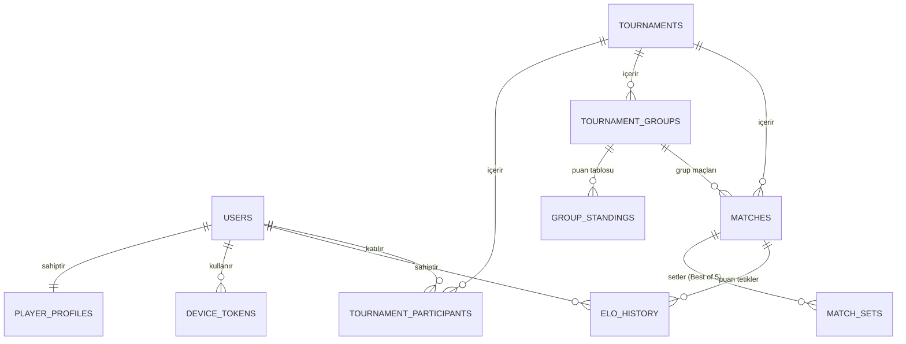

# MasaTenisim - Veritabanı Mimarisi ve Veri Modeli (PostgreSQL DDL)

**Proje Adı:** MasaTenisim  
**Tarih:** 16 Eylül 2026  
**Rol:** Kıdemli İş Analisti & Veri Mimarı  
**Veritabanı Motoru:** PostgreSQL 15+  
**Doküman Sürümü:** v1.0

---

## 1. Genel Mimari Yaklaşımı ve Prensipler

1. **İlişkisel Bütünlük (Relational Integrity):** ELO puan değişimleri, turnuva grupları ve set skorları birbirine sıkı sıkıya bağlıdır. Bu yüzden **PostgreSQL** tercih edilmiştir.
2. **Değişmez Denetim İzi (Immutable Audit Log):** `elo_history` tablosu asla silinmez veya güncellenmez; her puan hareketi veya admin düzeltmesi yeni bir satır olarak loglanır.
3. **Apple Uyumlu Güvenli Silme (Soft-Delete):** Apple Store şartı olan "Hesap Silme" için `users` tablosunda `deleted_at` kullanılır; oyuncu silinse bile geçmiş turnuvalardaki maç skorları bozulmaz ("Anonim Oyuncu" olarak kalır).
4. **Opsiyonel Ekipman ve Gizlilik:** Oyuncu ekipmanları `NULL` değer kabul eder.

---

## 2. Varlık-İlişki Diyagramı (ERD - Mermaid)



---

## 3. PostgreSQL Tablo Tanımları (DDL)

### 3.1. Özel Tipler (ENUMs)
```sql
CREATE TYPE user_role AS ENUM ('player', 'referee', 'super_admin');
CREATE TYPE play_style AS ENUM ('offensive', 'defensive', 'allround');
CREATE TYPE tournament_status AS ENUM ('draft', 'published', 'groups_active', 'knockout_active', 'completed', 'cancelled');
CREATE TYPE match_type AS ENUM ('tournament', 'friendly_ranked', 'friendly_casual');
CREATE TYPE match_status AS ENUM ('scheduled', 'in_progress', 'pending_approval', 'completed', 'disputed', 'cancelled');
CREATE TYPE elo_change_reason AS ENUM ('tournament_match', 'friendly_match', 'admin_adjustment', 'inactivity_penalty');
```

---

### 3.2. Kullanıcılar ve Oyuncu Profili
```sql
-- 1. USERS (Temel Kullanıcı ve Kimlik)
CREATE TABLE users (
    id UUID PRIMARY KEY DEFAULT gen_random_uuid(),
    phone VARCHAR(20) UNIQUE NOT NULL,       -- SMS/OTP girişi için
    email VARCHAR(255) UNIQUE,
    password_hash VARCHAR(255),
    full_name VARCHAR(100) NOT NULL,
    city VARCHAR(50) NOT NULL DEFAULT 'İstanbul',
    birth_date DATE NULL,                    -- Yaş hesabı ve kategori kontrolü için (Örn: 2008-04-15)
    birth_date_change_count INT NOT NULL DEFAULT 0, -- Yaş değişim sayısı (>=1 ise admin onayı gerekir)
    gender VARCHAR(10) NULL,                 -- 'male', 'female', 'unspecified'
    role user_role NOT NULL DEFAULT 'player',
    avatar_url TEXT,
    is_active BOOLEAN NOT NULL DEFAULT TRUE,
    created_at TIMESTAMP WITH TIME ZONE DEFAULT NOW(),
    updated_at TIMESTAMP WITH TIME ZONE DEFAULT NOW(),
    deleted_at TIMESTAMP WITH TIME ZONE NULL -- Apple hesap silme için soft-delete
);

-- 2. PLAYER_PROFILES (Masa Tenisi Oyuncu Detayları & İstatistikler)
CREATE TABLE player_profiles (
    user_id UUID PRIMARY KEY REFERENCES users(id) ON DELETE CASCADE,
    current_elo INT NOT NULL DEFAULT 1200,
    peak_elo INT NOT NULL DEFAULT 1200,
    k_factor INT NOT NULL DEFAULT 32,         -- İlk 10 maç 32, sonra 16
    total_matches INT NOT NULL DEFAULT 0,
    wins INT NOT NULL DEFAULT 0,
    losses INT NOT NULL DEFAULT 0,
    play_style play_style NULL,
    -- Opsiyonel Ekipmanlar (Gizlilik kuralına uygun)
    blade VARCHAR(100) NULL,                  -- Tahta
    forehand_rubber VARCHAR(100) NULL,        -- FH Lastik
    backhand_rubber VARCHAR(100) NULL,        -- BH Lastik
    is_equipment_public BOOLEAN DEFAULT TRUE,
    last_match_date TIMESTAMP WITH TIME ZONE NULL,
    updated_at TIMESTAMP WITH TIME ZONE DEFAULT NOW()
);
```

---

### 3.3. Turnuvalar, Gruplar ve Puan Tablosu
```sql
-- 3. TOURNAMENTS (Turnuva Ana Bilgileri & Kategori Kısıtlamaları)
CREATE TABLE tournaments (
    id UUID PRIMARY KEY DEFAULT gen_random_uuid(),
    title VARCHAR(150) NOT NULL,
    city VARCHAR(50) NOT NULL,
    location VARCHAR(200) NOT NULL,          -- Salon / Tesis adı
    start_date TIMESTAMP WITH TIME ZONE NOT NULL,
    table_count INT NOT NULL DEFAULT 4,       -- Salondaki masa sayısı
    max_participants INT NOT NULL DEFAULT 32,
    -- Yaş, Seviye ve Kategori Kriterleri
    min_age INT NULL,                        -- Örn: Veteranlar için 40
    max_age INT NULL,                        -- Örn: Gençler (U18) için 18
    min_elo INT NULL,                        -- Örn: Pro turnuva için 1500
    max_elo INT NULL,                        -- Örn: Başlangıç/Orta turnuva için 1350
    gender_category VARCHAR(20) NOT NULL DEFAULT 'open', -- 'open', 'men', 'women'
    status tournament_status NOT NULL DEFAULT 'draft',
    created_by UUID NOT NULL REFERENCES users(id),
    created_at TIMESTAMP WITH TIME ZONE DEFAULT NOW(),
    updated_at TIMESTAMP WITH TIME ZONE DEFAULT NOW()
);

-- 4. TOURNAMENT_PARTICIPANTS (Katılımcı Listesi & Seribaşı)
CREATE TABLE tournament_participants (
    id UUID PRIMARY KEY DEFAULT gen_random_uuid(),
    tournament_id UUID NOT NULL REFERENCES tournaments(id) ON DELETE CASCADE,
    user_id UUID NOT NULL REFERENCES users(id),
    seed_number INT NULL,                    -- Seribaşı numarası (1, 2, 3...)
    entry_elo INT NOT NULL,                  -- Turnuva başındaki ELO puanı
    final_rank INT NULL,                     -- Turnuva bitiş derecesi (1., 2., 3...)
    created_at TIMESTAMP WITH TIME ZONE DEFAULT NOW(),
    UNIQUE(tournament_id, user_id)
);

-- 5. TOURNAMENT_GROUPS (4'erli Gruplar)
CREATE TABLE tournament_groups (
    id UUID PRIMARY KEY DEFAULT gen_random_uuid(),
    tournament_id UUID NOT NULL REFERENCES tournaments(id) ON DELETE CASCADE,
    group_name VARCHAR(10) NOT NULL          -- 'Grup A', 'Grup B' vb.
);

-- 6. GROUP_STANDINGS (Grup Puan Durumu - Otomatik Hesaplanır)
CREATE TABLE group_standings (
    id UUID PRIMARY KEY DEFAULT gen_random_uuid(),
    group_id UUID NOT NULL REFERENCES tournament_groups(id) ON DELETE CASCADE,
    user_id UUID NOT NULL REFERENCES users(id),
    played INT NOT NULL DEFAULT 0,
    won INT NOT NULL DEFAULT 0,
    lost INT NOT NULL DEFAULT 0,
    points INT NOT NULL DEFAULT 0,           -- Galibiyet 2, Mağlubiyet 1
    sets_won INT NOT NULL DEFAULT 0,
    sets_lost INT NOT NULL DEFAULT 0,
    score_points_won INT NOT NULL DEFAULT 0,
    score_points_lost INT NOT NULL DEFAULT 0,
    rank_in_group INT NULL,                  -- Gruptaki sırası (1, 2, 3, 4)
    UNIQUE(group_id, user_id)
);
```

---

### 3.4. Maçlar ve Set Detayları (Best of 5)
```sql
-- 7. MATCHES (Maçlar)
CREATE TABLE matches (
    id UUID PRIMARY KEY DEFAULT gen_random_uuid(),
    tournament_id UUID NULL REFERENCES tournaments(id) ON DELETE SET NULL,
    group_id UUID NULL REFERENCES tournament_groups(id) ON DELETE SET NULL,
    round_name VARCHAR(50) NULL,             -- 'Grup Maçı', 'Çeyrek Final', 'Final'
    table_number INT NULL,                   -- Salondaki masa no (1, 2, 3, 4)
    match_type match_type NOT NULL,          -- tournament, friendly_ranked, friendly_casual
    player1_id UUID NOT NULL REFERENCES users(id),
    player2_id UUID NOT NULL REFERENCES users(id),
    winner_id UUID NULL REFERENCES users(id),
    score_p1 INT NOT NULL DEFAULT 0,         -- P1'in aldığı set (örn: 3)
    score_p2 INT NOT NULL DEFAULT 0,         -- P2'nin aldığı set (örn: 1)
    status match_status NOT NULL DEFAULT 'scheduled',
    submitted_by UUID NULL REFERENCES users(id),  -- Skoru ilk giren
    approved_by UUID NULL REFERENCES users(id),   -- Skoru onaylayan rakip/hakem
    p1_elo_before INT NULL,
    p1_elo_after INT NULL,
    p2_elo_before INT NULL,
    p2_elo_after INT NULL,
    played_at TIMESTAMP WITH TIME ZONE,
    created_at TIMESTAMP WITH TIME ZONE DEFAULT NOW()
);

-- 8. MATCH_SETS (Set Skorları - Best of 5)
CREATE TABLE match_sets (
    id UUID PRIMARY KEY DEFAULT gen_random_uuid(),
    match_id UUID NOT NULL REFERENCES matches(id) ON DELETE CASCADE,
    set_number INT NOT NULL,                 -- 1, 2, 3, 4, 5
    p1_score INT NOT NULL,                   -- Örn: 11
    p2_score INT NOT NULL,                   -- Örn: 8
    winner_id UUID NOT NULL REFERENCES users(id)
);
```

---

### 3.5. ELO Geçmişi & Push Bildirim Modülü
```sql
-- 9. ELO_HISTORY (Denetim İzi & Değişmez Log)
CREATE TABLE elo_history (
    id UUID PRIMARY KEY DEFAULT gen_random_uuid(),
    user_id UUID NOT NULL REFERENCES users(id) ON DELETE CASCADE,
    match_id UUID NULL REFERENCES matches(id) ON DELETE SET NULL,
    old_elo INT NOT NULL,
    new_elo INT NOT NULL,
    change_amount INT NOT NULL,              -- +18, -12 vb.
    reason elo_change_reason NOT NULL,
    notes TEXT NULL,                         -- Admin düzeltme gerekçesi
    adjusted_by UUID NULL REFERENCES users(id), -- İşlemi yapan Admin
    created_at TIMESTAMP WITH TIME ZONE DEFAULT NOW()
);

-- 10. DEVICE_TOKENS (Push Bildirim Cihaz Anahtarları)
CREATE TABLE device_tokens (
    id UUID PRIMARY KEY DEFAULT gen_random_uuid(),
    user_id UUID NOT NULL REFERENCES users(id) ON DELETE CASCADE,
    expo_push_token TEXT NOT NULL UNIQUE,
    platform VARCHAR(10) NOT NULL,           -- 'ios' veya 'android'
    updated_at TIMESTAMP WITH TIME ZONE DEFAULT NOW()
);

-- 11. PUSH_CAMPAIGNS (Admin Turnuva Çağrıları)
CREATE TABLE push_campaigns (
    id UUID PRIMARY KEY DEFAULT gen_random_uuid(),
    title VARCHAR(150) NOT NULL,
    body TEXT NOT NULL,
    target_city VARCHAR(50) NULL,            -- Sadece İstanbul'a at
    min_elo INT NULL,
    max_elo INT NULL,
    sent_count INT NOT NULL DEFAULT 0,
    sent_by UUID NOT NULL REFERENCES users(id),
    sent_at TIMESTAMP WITH TIME ZONE DEFAULT NOW()
);

-- 12. PROFILE_CHANGE_REQUESTS (Doğum Tarihi & Profil Değişiklik Onay Talepleri)
CREATE TABLE profile_change_requests (
    id UUID PRIMARY KEY DEFAULT gen_random_uuid(),
    user_id UUID NOT NULL REFERENCES users(id) ON DELETE CASCADE,
    field_name VARCHAR(50) NOT NULL DEFAULT 'birth_date',
    old_value TEXT NULL,
    new_value TEXT NOT NULL,
    reason TEXT NOT NULL,                    -- "Yanlış yıl girdim, kimlikteki tarihim budur"
    status VARCHAR(20) NOT NULL DEFAULT 'pending', -- 'pending', 'approved', 'rejected'
    reviewed_by UUID NULL REFERENCES users(id),    -- Talebi onaylayan/reddeden admin
    reviewed_at TIMESTAMP WITH TIME ZONE NULL,
    admin_notes TEXT NULL,
    created_at TIMESTAMP WITH TIME ZONE DEFAULT NOW()
);
```

---

## 4. Performans İndeksleri (Leaderboard & Fikstür Optimizasyonu)

Mobil uygulamada binlerce oyuncunun olduğu liderlik tablosunu ve canlı fikstürü 5 milisaniyenin altında çekmek için kritik indeksler:

```sql
-- Liderlik tablosu için ELO sıralama indeksi (En çok çalışacak sorgu)
CREATE INDEX idx_player_profiles_elo ON player_profiles(current_elo DESC);

-- Şehir bazlı liderlik tablosu için birleşik indeks
CREATE INDEX idx_users_city_active ON users(city, is_active) WHERE deleted_at IS NULL;

-- Turnuva maçları ve oyuncu maç geçmişi indeksleri
CREATE INDEX idx_matches_tournament ON matches(tournament_id);
CREATE INDEX idx_matches_players ON matches(player1_id, player2_id);
CREATE INDEX idx_elo_history_user ON elo_history(user_id, created_at DESC);

---

## 5. History (Tarihçe) Tabloları ve Otomatik Tetikleyiciler (Triggers)

Turnuva skorlarında şaibe, hakem hataları veya oyuncu profillerinde geçmişe dönük denetim yapabilmek için PostgreSQL **PL/pgSQL Trigger** mimarisi eklenmiştir. Bu sayede backend kodu unutsun veya doğrudan SQL müdahalesi yapılsın; veritabanı motoru her değişikliği anında tarihçeye kopyalar.

### 5.1. History Tabloları
```sql
-- 1. MAÇ SKORU VE DURUM TARİHÇESİ (Matches History)
CREATE TABLE matches_history (
    history_id UUID PRIMARY KEY DEFAULT gen_random_uuid(),
    match_id UUID NOT NULL,
    action VARCHAR(10) NOT NULL,              -- 'UPDATE', 'DELETE'
    old_score_p1 INT,
    new_score_p1 INT,
    old_score_p2 INT,
    new_score_p2 INT,
    old_winner_id UUID,
    new_winner_id UUID,
    old_status match_status,
    new_status match_status,
    changed_by UUID NULL,                     -- Değiştiren kişi
    changed_at TIMESTAMP WITH TIME ZONE DEFAULT NOW()
);

-- 2. OYUNCU PROFİLİ VE ELO DEĞİŞİM TARİHÇESİ (Player Profiles History)
CREATE TABLE player_profiles_history (
    history_id UUID PRIMARY KEY DEFAULT gen_random_uuid(),
    user_id UUID NOT NULL,
    action VARCHAR(10) NOT NULL,
    old_current_elo INT,
    new_current_elo INT,
    old_k_factor INT,
    new_k_factor INT,
    old_wins INT,
    new_wins INT,
    old_losses INT,
    new_losses INT,
    old_blade VARCHAR(100),
    new_blade VARCHAR(100),
    old_forehand_rubber VARCHAR(100),
    new_forehand_rubber VARCHAR(100),
    old_backhand_rubber VARCHAR(100),
    new_backhand_rubber VARCHAR(100),
    changed_at TIMESTAMP WITH TIME ZONE DEFAULT NOW()
);

-- 3. TURNUVA DURUM VE AYAR TARİHÇESİ (Tournaments History)
CREATE TABLE tournaments_history (
    history_id UUID PRIMARY KEY DEFAULT gen_random_uuid(),
    tournament_id UUID NOT NULL,
    action VARCHAR(10) NOT NULL,
    old_status tournament_status,
    new_status tournament_status,
    old_table_count INT,
    new_table_count INT,
    old_start_date TIMESTAMP WITH TIME ZONE,
    new_start_date TIMESTAMP WITH TIME ZONE,
    changed_at TIMESTAMP WITH TIME ZONE DEFAULT NOW()
);
```

---

### 5.2. Otomatik Tetikleyici Fonksiyonlar (PL/pgSQL Trigger Functions)

```sql
-- 1. MAÇ GÜNCELLEMELERİNİ YAKALAYAN TETİKLEYİCİ
CREATE OR REPLACE FUNCTION trg_fn_matches_audit()
RETURNS TRIGGER AS $$
BEGIN
    IF (TG_OP = 'UPDATE') THEN
        -- Sadece skor, kazanan veya durum değiştiğinde tarihçeye yaz
        IF (OLD.score_p1 IS DISTINCT FROM NEW.score_p1 OR
            OLD.score_p2 IS DISTINCT FROM NEW.score_p2 OR
            OLD.winner_id IS DISTINCT FROM NEW.winner_id OR
            OLD.status IS DISTINCT FROM NEW.status) THEN
            
            INSERT INTO matches_history (
                match_id, action,
                old_score_p1, new_score_p1,
                old_score_p2, new_score_p2,
                old_winner_id, new_winner_id,
                old_status, new_status,
                changed_by, changed_at
            ) VALUES (
                OLD.id, 'UPDATE',
                OLD.score_p1, NEW.score_p1,
                OLD.score_p2, NEW.score_p2,
                OLD.winner_id, NEW.winner_id,
                OLD.status, NEW.status,
                NEW.approved_by, NOW()
            );
        END IF;
        RETURN NEW;
    ELSIF (TG_OP = 'DELETE') THEN
        INSERT INTO matches_history (
            match_id, action,
            old_score_p1, old_score_p2,
            old_winner_id, old_status,
            changed_at
        ) VALUES (
            OLD.id, 'DELETE',
            OLD.score_p1, OLD.score_p2,
            OLD.winner_id, OLD.status,
            NOW()
        );
        RETURN OLD;
    END IF;
    RETURN NULL;
END;
$$ LANGUAGE plpgsql;

-- 2. OYUNCU PROFİLİ DEĞİŞİKLİKLERİNİ YAKALAYAN TETİKLEYİCİ
CREATE OR REPLACE FUNCTION trg_fn_player_profiles_audit()
RETURNS TRIGGER AS $$
BEGIN
    INSERT INTO player_profiles_history (
        user_id, action,
        old_current_elo, new_current_elo,
        old_k_factor, new_k_factor,
        old_wins, new_wins,
        old_losses, new_losses,
        old_blade, new_blade,
        old_forehand_rubber, new_forehand_rubber,
        old_backhand_rubber, new_backhand_rubber,
        changed_at
    ) VALUES (
        OLD.user_id, TG_OP,
        OLD.current_elo, NEW.current_elo,
        OLD.k_factor, NEW.k_factor,
        OLD.wins, NEW.wins,
        OLD.losses, NEW.losses,
        OLD.blade, NEW.blade,
        OLD.forehand_rubber, NEW.forehand_rubber,
        OLD.backhand_rubber, NEW.backhand_rubber,
        NOW()
    );
    RETURN NEW;
END;
$$ LANGUAGE plpgsql;

-- 3. TURNUVA DEĞİŞİKLİKLERİNİ YAKALAYAN TETİKLEYİCİ
CREATE OR REPLACE FUNCTION trg_fn_tournaments_audit()
RETURNS TRIGGER AS $$
BEGIN
    INSERT INTO tournaments_history (
        tournament_id, action,
        old_status, new_status,
        old_table_count, new_table_count,
        old_start_date, new_start_date,
        changed_at
    ) VALUES (
        OLD.id, TG_OP,
        OLD.status, NEW.status,
        OLD.table_count, NEW.table_count,
        OLD.start_date, NEW.start_date,
        NOW()
    );
    RETURN NEW;
END;
$$ LANGUAGE plpgsql;
```

---

### 5.3. Tetikleyicileri Tablolara Bağlama (Binding Triggers)

```sql
-- Maç tablosuna bağlama
CREATE TRIGGER trg_matches_audit_change
AFTER UPDATE OR DELETE ON matches
FOR EACH ROW EXECUTE FUNCTION trg_fn_matches_audit();

-- Oyuncu profili tablosuna bağlama
CREATE TRIGGER trg_player_profiles_audit_change
AFTER UPDATE ON player_profiles
FOR EACH ROW EXECUTE FUNCTION trg_fn_player_profiles_audit();

-- Turnuva tablosuna bağlama
CREATE TRIGGER trg_tournaments_audit_change
AFTER UPDATE ON tournaments
FOR EACH ROW EXECUTE FUNCTION trg_fn_tournaments_audit();
```

---

## 6. Canlı Veritabanı Dağıtımı ve Durum (Neon.tech PostgreSQL)

* **Dağıtım Tarihi:** 16 Eylül 2026
* **Platform:** [Neon.tech](https://neon.tech) Serverless PostgreSQL (AWS us-east-2)
* **Bağlantı Türü:** Connection Pooler (SSL şifreli)
* **Konfigürasyon:** `.env` ve `packages/database/.env`
* **Aktarım Durumu:**
  * ✅ 15 Tablo ve ENUM tipleri eksiksiz oluşturuldu.
  * ✅ 3 Audit Tetikleyicisi (`matches`, `player_profiles`, `tournaments`) aktif edildi.
  * ✅ Demo Seed verileri (6 kullanıcı, 4 oyuncu profili, 2 turnuva) yüklendi.
* **Migration Komutu:** `packages/database` dizininde `npm run migrate` çalıştırılarak şema ve veriler her zaman sıfırdan veya güncel olarak senkronize edilebilir.
